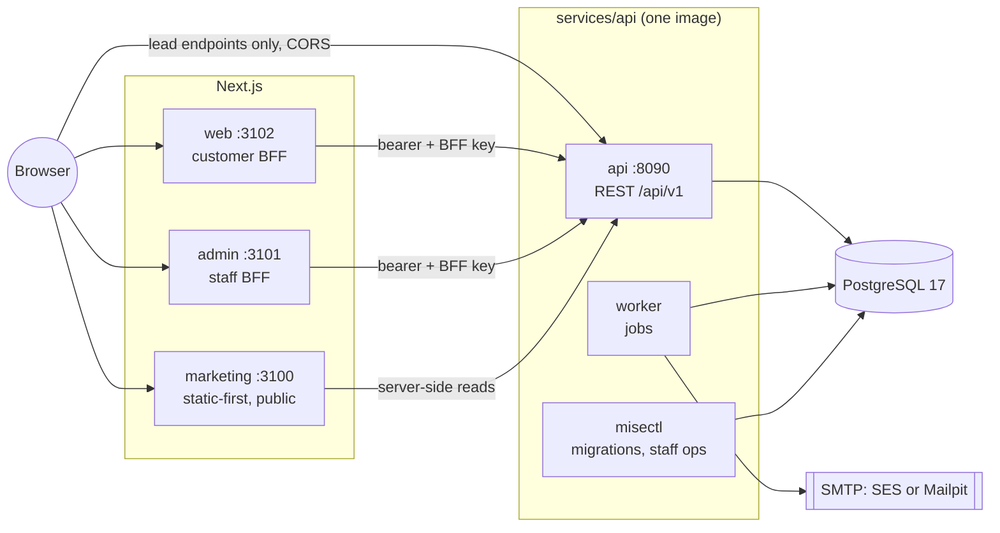

# Container architecture

| Container | Tech | Responsibility | Holds secrets |
|---|---|---|---|
| marketing | Next.js 16 | Brand, SEO, waitlist, referrals. No account code. | none |
| web | Next.js 16 | Customer accounts (Sprint 1: sign-up, verify, sign-in, reset, sessions). Cookie `mise_session`. | `BFF_SHARED_KEY` |
| admin | Next.js 16 | Staff console: sign-in with MFA, dashboard, leads. Cookie `mise_admin`. | `BFF_SHARED_KEY` |
| api | Go | All business rules, authentication, authorisation, persistence. | DB, `TOKEN_SIGNING_KEY`, `DATA_ENCRYPTION_KEY`, `BFF_SHARED_KEY` |
| worker | Go (same image) | Email jobs; later renewals, notifications, schedules. | DB, SMTP, keys |
| misectl | Go (same image) | Migrations (before each deploy), staff accounts, `doctor`. | DB, keys |
| PostgreSQL | 17 | System of record and job queue | |

## Environments

| | Local | Staging | Production |
|---|---|---|---|
| Runs on | Docker Compose (`docker compose up`) or host processes | AWS ECS Fargate (Terraform, not yet applied) | AWS ECS Fargate, or the single-server compose/systemd path |
| Database | Compose PostgreSQL, separate `mise_test` for tests | own RDS | own RDS, Multi-AZ |
| Email | Mailpit (http://localhost:8026) | SES | SES |
| MFA | off by default | required | required (cannot be disabled) |
| Registration | open | closed by default | closed by default |

## What is not deployed yet

The `web` container runs locally only. Adding it to AWS (a fifth Fargate service, an ALB
host rule for `app.<domain>`, DNS) costs about US$9 to 12 a month per environment and waits
for approval (ADR-005). The single-server compose file also does not run it yet.

## Observability

- JSON logs (`slog`) with `service`, `env`, `request_id`, `trace_id`, route pattern,
  status and duration. Never bodies, query strings or tokens.
- `GET /api/v1/health` (process) and `GET /api/v1/ready` (database ping, 2 s), used by the
  ALB and Compose health checks. Neither exposes internals.
- CloudWatch metric filters and alarms on log events (pre-launch: `LeadsCreated`,
  `JobsFailed`, `ApiErrors`, `AdminLoginsFailed`, …). Sprint 1's auth events
  (`auth.login_failed`, `auth.mfa_failed`) use the same `event` field and can be added as filters.
- Failed jobs stay in `jobs` with `status = 'failed'` and `last_error`: the dead-letter set.
- Tracing: trace context is read and logged; OpenTelemetry export is a later step (ADR-005).
