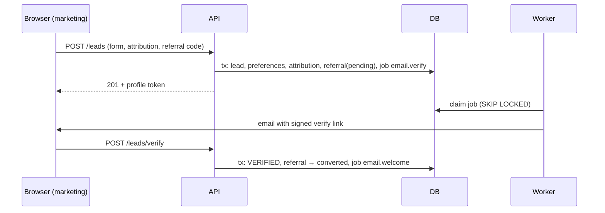
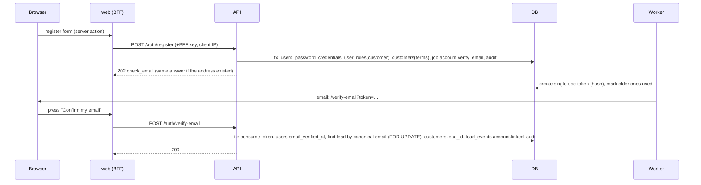
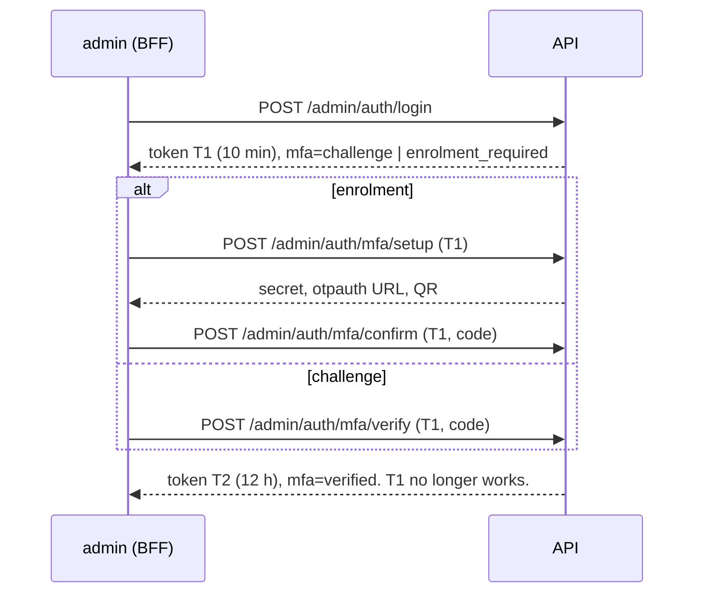

# Data flow

## 1. Waitlist signup (pre-launch, unchanged)

## 2. Customer registration and the lead link (Sprint 1)

Lead-to-customer rules:

- **Never automatic in bulk.** A link happens only when a person registers and proves the inbox.
- Matching uses the canonical email, so `asha+mise@example.com` finds the lead `asha@example.com`.
- One lead links to at most one customer (unique constraint).
- Blocked leads are not linked.
- The lead row, its status, referrals, attribution, consent and events are untouched;
  one `account.linked` event is appended. Consent stays traceable on both sides:
  marketing consent on the lead, terms consent on the customer.
- `leads.status = CONVERTED` is **not** set in Sprint 1. When it is set (for example on a
  first order) is a business decision for Sprint 2.
- Erasing the lead later keeps the customer and clears the link.

## 3. Admin sign-in with MFA

## 4. Every authenticated request

1. `WithRequestID` (request id, trace id) → `WithClientIP` (socket / X-Forwarded-For /
   BFF-forwarded address) → access log → recover → security headers → CORS → general limit.
2. Route-level limit, then `Require*`: session by token hash and audience, idle and
   absolute expiry, user active, roles and permissions re-read, MFA state.
3. Handler; changes and their audit entries in one transaction.

## 5. Background jobs

- Enqueued with the caller's transaction (transactional outbox). Payload: ids only.
- Worker claims with `FOR UPDATE SKIP LOCKED`, runs with a 30 s timeout, retries at 30 s,
  2 m, 8 m, 32 m, then marks `failed` (the dead-letter set). Stuck `running` jobs return
  to the queue after 10 minutes.
- Handlers re-read current state and skip work that is no longer wanted (unsubscribed
  lead, already-verified account), which makes them safe to run twice.
- **Conventions for later job kinds**: name `domain.event` with a version suffix when the
  payload changes incompatibly (`order.confirmed.v2`), keep the old handler until the
  queue drains; for work with external effects (charging a card, booking a courier), add
  an `idempotency_key` to the job and pass it to the provider.

## 6. Personal data

| Data | Where | Leaves Mise to |
|---|---|---|
| Lead details and preferences | leads tables | SES (email address, first name) |
| Account email, names | users | SES |
| Passwords | Argon2id hashes only | nowhere |
| Client IP | keyed hash on leads and sessions; raw only in memory for rate limits | nowhere |
| User agent | sessions (≤ 256 chars) | nowhere |
| CSV exports | streamed to an authorised, audited admin | the admin's device |
