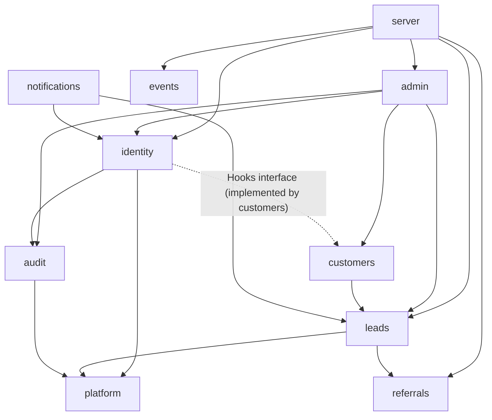

# Module boundaries

The backend is one Go module with one package per business domain under
`services/api/internal/`. This page says who owns what and who may depend on whom.

## Rules

1. A module owns its tables. Only its code reads or writes them.
2. Another module uses it through exported functions, or through an interface the
   **caller** defines and the owner implements (dependency inversion). No cross-module SQL.
3. Dependencies point one way; there are no cycles (the Go compiler enforces this for
   imports). `platform/*` depends on no domain.
4. Every change that must stay consistent happens in one transaction (`db.InTx`),
   passed down as `db.Querier`, including audit entries and job enqueues.
5. No generic framework layers: a module is handlers, a service, its SQL, its tests.

## Today

| Module | Owns | Exposes |
|---|---|---|
| `platform/*` | nothing | config, db (pool, `InTx`, migrations), httpx (envelope, errors, middleware, `Router`), jobs, mail, ratelimit, token (lead HMAC), crypto (sealing), email (canonical form) |
| `identity` (new) | users, password_credentials, sessions, auth_tokens, mfa_totp, roles, permissions, role_permissions, user_roles | `Service` (`Login`, `Authenticate`, `Register`, `VerifyEmail`, MFA, reset, sessions, operator actions), `RequireCustomer`, `RequireAdmin(perm)`, `PrincipalFrom`, `Hooks` interface, permission constants |
| `customers` (new) | customers | `Hooks` (create on registration, link lead on verification), `LinkForLead` |
| `leads` | leads, lead_preferences, lead_attribution | signup, verification, preferences, unsubscribe, erasure; `FindForAccount`, `RecordEvent` for accounts |
| `referrals` | referrals | codes, referrer lookup, conversion, counts |
| `events` | lead_events (client-sent) | ingestion with an allow-list |
| `admin` | nothing of its own | back-office lead features; asks identity for access |
| `audit` (new) | audit_log | `Record(ctx, q, Entry)` |
| `notifications` | email templates | job handlers for lead and account emails |
| `server` | nothing | wiring and the route table |

`admin_users` and `admin_sessions` are owned by no module now; they are kept for rollback
and will be removed by a later, approved migration.

## Planned modules

Created when their sprint starts, not before (no empty packages):

| Module | Will own | Depends on |
|---|---|---|
| `catalog` | plans, meals, weekly menus, menu items | recipes (read) |
| `subscriptions` | subscriptions, billing cycles, pauses, plan changes | customers, catalog, payments (interface) |
| `orders` | orders, items, state transitions | subscriptions, catalog, customers |
| `payments` | payment intents, refunds, provider references; provider adapter | — (others call it) |
| `recipes`, `nutrition` | recipes, ingredients, allergens, reviews | — |
| `suppliers`, `procurement`, `inventory` | suppliers (scoped roles), purchase orders, lots | recipes (read) |
| `production`, `fulfillment` | batches, consumption, packing | orders, inventory |
| `delivery` | deliveries; partner adapter (Food Drop or others) | orders |
| `crm`, `loyalty`, `analytics` | segments, points, aggregates | read models fed by jobs |

Cross-domain workflows (an order confirmed → production planned → delivery booked) run
through jobs written in the same transaction as the triggering change (outbox), not
through direct calls across several modules in one request.
