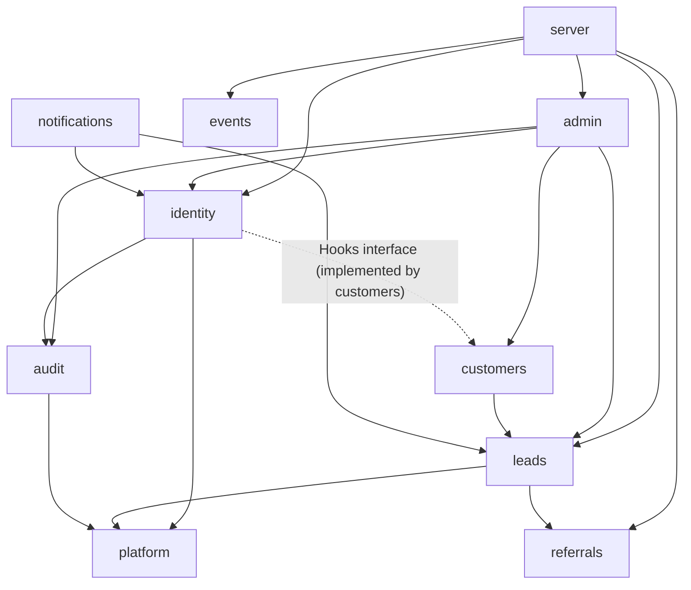

# Module boundaries

The backend is one Go module with one package per business domain under
`services/api/internal/`. This page says who owns what and who may depend on whom.

## Rules

1. A module owns its tables. Only its code reads or writes them.
2. Another module uses it through exported functions, or through an interface the
   **caller** defines and the owner implements (dependency inversion). No cross-module SQL.
3. Dependencies point one way; there are no cycles (the Go compiler enforces this for
   imports). `platform/*` depends on no domain.
4. Every change that must stay consistent happens in one transaction (`db.InTx`),
   passed down as `db.Querier`, including audit entries and job enqueues.
5. No generic framework layers: a module is handlers, a service, its SQL, its tests.

## Today

| Module | Owns | Exposes |
|---|---|---|
| `platform/*` | nothing | config, db (pool, `InTx`, migrations), httpx (envelope, errors, middleware, `Router`), jobs, mail, ratelimit, token (lead HMAC), crypto (sealing), email (canonical form) |
| `identity` (new) | users, password_credentials, sessions, auth_tokens, mfa_totp, roles, permissions, role_permissions, user_roles | `Service` (`Login`, `Authenticate`, `Register`, `VerifyEmail`, MFA, reset, sessions, operator actions), `RequireCustomer`, `RequireAdmin(perm)`, `PrincipalFrom`, `Hooks` interface, permission constants |
| `customers` (new) | customers | `Hooks` (create on registration, link lead on verification), `LinkForLead` |
| `leads` | leads, lead_preferences, lead_attribution | signup, verification, preferences, unsubscribe, erasure; `FindForAccount`, `RecordEvent` for accounts |
| `referrals` | referrals | codes, referrer lookup, conversion, counts |
| `events` | lead_events (client-sent) | ingestion with an allow-list |
| `admin` | nothing of its own | back-office lead features; asks identity for access |
| `audit` (new) | audit_log | `Record(ctx, q, Entry)` |
| `notifications` | email templates | job handlers for lead and account emails |
| `server` | nothing | wiring and the route table; `NewCommerce` builds the commerce services for the API, the worker and misectl |
| `plans` (Sprint 3) | subscription_plans, subscription_plan_prices | public plans, `ForPurchase` (the exact price row a sale uses), admin, demo seed |
| `menus` (Sprint 3) | weekly_menus, weekly_menu_meals | the cutoff `Policy` and week arithmetic, publishing, `ForWeek`; `Usage` interface (implemented by subscriptions), `Hooks` (implemented by commerce) |
| `subscriptions` (Sprint 3) | subscriptions, subscription_events/changes/pauses, subscription_cycles, meal_selections, meal_selection_items | the state machine, `EnsureCycle`, selection `Save` and `Lock` |
| `billing` (Sprint 3) | billing_cycles, invoices, invoice_items, invoice_counters, promotions, promotion_redemptions | `Policy.Quote`, `CreateCycle`, `MarkPaid`, `Void`, invoices and PDF; `Issuer` interface (implemented by subscriptions) |
| `payments` (Sprint 3) | checkout_sessions, payments, payment_status_history, payment_webhook_events, refunds, payment_methods | the `Provider` interface, checkout, webhooks, reconciliation, charges, refunds; `Hooks` interface (implemented by commerce) |
| `payments/testpay` (Sprint 3) | testpay_sessions, testpay_transactions | the payment simulator; never in production |
| `payments` provider registry (Sprint 9.1) | payment_provider_settings, payment_provider_events | eligibility and `GET /payment-options`, staff settings and live activation; see `PAYMENT_ARCHITECTURE.md` |
| `payments/stripe`, `payments/paypal`, `payments/scotiabank` (Sprint 9.1) | none (provider state lives at the provider) | adapters behind the `Provider` interface; Scotiabank blocked |
| `supportchat` (Sprint 9.1) | support_conversations, support_messages, support_read_positions, support_conversation_events, support_internal_notes, support_saved_replies, support_feedback, support_guest_sessions, support_chat_settings, support_holidays, support_chat_notifications, help_categories, help_articles, help_article_events | Mise Chat (owner, guest and agent APIs, SSE streams, LISTEN/NOTIFY hub) and the help centre; uses `support` (cases), the alert centre and the job queue; see `SUPPORT_CHAT.md` |
| `orders` (Sprint 3) | orders, order_items, order_status_history, order_counters | `Create` (once per cycle), history, `Demand` |
| `commerce` (Sprint 3) | notification_deliveries | the workflows across those modules, each in one transaction: subscribe, pay, payment outcomes, pause, cancel and plan change, selection, and the scheduler `Tick` |

`admin_users` and `admin_sessions` are owned by no module now; they are kept for rollback
and will be removed by a later, approved migration.

## Planned modules

Created when their sprint starts, not before (no empty packages):

| Module | Will own | Depends on |
|---|---|---|
| `recipes`, `nutrition` | recipes, ingredients, allergens, reviews | — |
| `suppliers`, `procurement`, `inventory` | suppliers (scoped roles), purchase orders, lots | recipes (read) |
| `production`, `fulfillment` | batches, consumption, packing | orders, inventory |
| `delivery` | deliveries; partner adapter (Food Drop or others) | orders |
| `crm`, `loyalty`, `analytics` | segments, points, aggregates | read models fed by jobs |

Cross-domain workflows (an order confirmed → production planned → delivery booked) run
through jobs written in the same transaction as the triggering change (outbox), not
through direct calls across several modules in one request.
