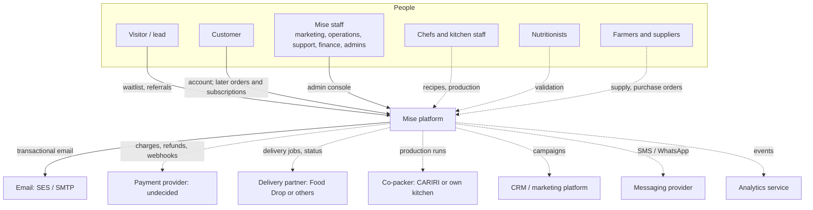

# System context

Who and what the Mise platform deals with. Solid lines exist today; dashed lines are
planned integration boundaries, deliberately not implemented until credentials, API
documentation and business terms are confirmed.

## Integration rules

- Every external party sits behind an interface owned by one module (`notifications`
  for email, later `payments`, `delivery`, `crm`). Domain code never names a provider.
- Food Drop, CARIRI and any payment provider are **configuration of an adapter**, not
  assumptions spread through the code. Switching delivery partner, or bringing
  production in-house, replaces an adapter.
- No adapter is written against a guessed API. Each needs the provider's documentation,
  sandbox credentials and agreed business rules first. None exist yet.
- Inbound webhooks (later) are verified (signature), stored raw, deduplicated by provider
  event id, and processed by a job.
