# Conceptual ERD: the eventual platform

Entities and relationships for the whole Mise platform. **Only the shaded Sprint 1 part
exists** (see `SPRINT_1_SCHEMA.md`); everything else is a boundary to design against, not
a commitment to these exact tables. Each group is owned by one module (`MODULE_BOUNDARIES.md`).

The business chain the model serves:
**Customers → Subscriptions → Orders → Recipes → Ingredients → Farmers → Procurement → Production → Delivery.**

```mermaid
erDiagram
  %% ---------- Identity (built) ----------
  USER ||--o| PASSWORD_CREDENTIAL : "signs in with"
  USER ||--o{ SESSION : has
  USER ||--o{ USER_ROLE : holds
  ROLE ||--o{ ROLE_PERMISSION : grants
  PERMISSION ||--o{ ROLE_PERMISSION : ""
  ROLE ||--o{ USER_ROLE : ""
  USER ||--o| MFA_TOTP : "protected by"

  %% ---------- Leads (built pre-launch) ----------
  LEAD ||--o| LEAD_PREFERENCES : states
  LEAD ||--o{ LEAD_ATTRIBUTION : "arrived via"
  LEAD ||--o{ LEAD_EVENT : history
  LEAD ||--o{ REFERRAL : "referred"

  %% ---------- Customers (link built; the rest later) ----------
  USER ||--o| CUSTOMER : "is a"
  CUSTOMER |o--o| LEAD : "was (linked)"
  CUSTOMER ||--o{ ADDRESS : "delivers to"
  CUSTOMER }o--o| HOUSEHOLD : "belongs to"
  CUSTOMER ||--o{ DIETARY_PREFERENCE : states
  CUSTOMER ||--o{ CUSTOMER_ALLERGEN : avoids
  ALLERGEN ||--o{ CUSTOMER_ALLERGEN : ""

  %% ---------- Catalog ----------
  PLAN ||--o{ SUBSCRIPTION : "subscribed as"
  WEEKLY_MENU ||--o{ MENU_ITEM : offers
  MEAL ||--o{ MENU_ITEM : "appears in"
  MEAL }o--|| RECIPE : "made from"

  %% ---------- Subscriptions and orders ----------
  CUSTOMER ||--o{ SUBSCRIPTION : holds
  SUBSCRIPTION ||--o{ BILLING_CYCLE : "billed in"
  SUBSCRIPTION ||--o{ SUBSCRIPTION_PAUSE : "paused by"
  SUBSCRIPTION ||--o{ PLAN_CHANGE : "changed by"
  SUBSCRIPTION ||--o{ ORDER : generates
  ORDER ||--|{ ORDER_ITEM : contains
  ORDER_ITEM }o--|| MENU_ITEM : "chosen from"
  ORDER ||--o{ ORDER_TRANSITION : "moved through"
  ORDER ||--o{ PAYMENT : "paid by"
  ORDER }o--|| ADDRESS : "ships to"

  %% ---------- Recipes and nutrition ----------
  RECIPE ||--|{ RECIPE_INGREDIENT : uses
  INGREDIENT ||--o{ RECIPE_INGREDIENT : ""
  INGREDIENT }o--o{ ALLERGEN : contains
  RECIPE ||--o{ NUTRITION_REVIEW : "validated by"

  %% ---------- Supply and operations ----------
  SUPPLIER ||--o{ SUPPLIER_PRODUCT : offers
  INGREDIENT ||--o{ SUPPLIER_PRODUCT : "sourced as"
  SUPPLIER ||--o{ PURCHASE_ORDER : receives
  PURCHASE_ORDER ||--|{ PURCHASE_ORDER_LINE : lists
  PURCHASE_ORDER_LINE ||--o{ INVENTORY_LOT : "received as"
  INGREDIENT ||--o{ INVENTORY_LOT : stocked
  PRODUCTION_BATCH }o--|| WEEKLY_MENU : "produces for"
  PRODUCTION_BATCH ||--o{ BATCH_CONSUMPTION : consumes
  INVENTORY_LOT ||--o{ BATCH_CONSUMPTION : ""
  ORDER ||--o| DELIVERY : "fulfilled by"
  DELIVERY }o--|| DELIVERY_PARTNER : "carried by"

  %% ---------- Cross-cutting ----------
  USER ||--o{ AUDIT_ENTRY : performs
```

## Notes that shape later design

- **Lead and customer stay separate.** A lead is a marketing record with consent and
  attribution; a customer is a commercial record. `customers.lead_id` links them, so
  history is read, never copied.
- **Scoped roles.** Farmers act for a `SUPPLIER`, kitchen staff for a kitchen. Their
  `USER_ROLE` rows carry that scope; every supplier and production query filters by it.
- **Integration boundaries.** `DELIVERY_PARTNER` (Food Drop or others) and `PAYMENT`
  (provider undecided) hold provider references and status only; provider-specific
  behaviour stays in adapters (`MODULE_BOUNDARIES.md`). The co-packer (CARIRI) is a
  production location, not a hard-coded assumption.
- **Time.** Menus, delivery days and cut-offs are business dates in
  `America/Port_of_Spain`; instants (paid at, delivered at) are UTC `timestamptz`.
- **Money** (later): integer minor units plus an ISO currency code (TTD), never floats.
