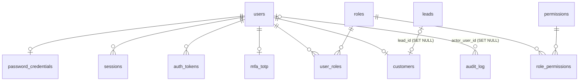

# Sprint 1 physical schema

Migration `services/api/migrations/00004_identity.sql`. The pre-launch tables (00001 to
00003) are unchanged and documented in `schema.md`; the only change to them is two new
nullable columns on `audit_log`.

## Tables

### users
| Column | Type | Notes |
|---|---|---|
| id | uuid PK | Admins copied from `admin_users` keep their id |
| email | text, 3 to 254 | Deliverable form, lower-cased |
| email_canonical | text, **unique** | No `+tag`, no Gmail dots: same rule as `leads.email_canonical` |
| email_verified_at | timestamptz null | |
| first_name, last_name | text ≤ 80 | |
| status | `active` \| `disabled` | |
| last_login_at, created_at, updated_at | timestamptz | |

### password_credentials
`user_id` PK → users (CASCADE), `password_hash` (Argon2id PHC), `updated_at`. Separate so an
account can exist with only an external identity later.

### sessions
| Column | Notes |
|---|---|
| id uuid PK, user_id → users CASCADE | |
| token_hash bytea **unique** | SHA-256 of the token |
| audience | `customer` \| `admin` |
| client | `web` \| `mobile` (reserved) |
| mfa_verified_at | set when the second factor was presented in this session |
| user_agent ≤ 256, ip_hash | keyed hash, never the raw address |
| created_at, last_seen_at, expires_at | idle limit applied against last_seen_at |
| revoked_at, revoked_reason | both or neither (CHECK); reason from a fixed list |

Indexes: `(user_id) WHERE revoked_at IS NULL`, `(expires_at)`.

### auth_tokens
Single-use email tokens: `user_id`, `purpose` (`verify_email` \| `reset_password`),
`token_hash` unique, `expires_at`, `consumed_at`. Index on open tokens per user and purpose.

### mfa_totp
`user_id` PK, `secret_ciphertext` (AES-256-GCM), `confirmed_at` (null while enrolling),
`last_used_step` (replay guard).

### roles, permissions, role_permissions, user_roles
- `roles.key` text PK (`^[a-z][a-z_]{1,39}$`); 11 seeded.
- `permissions.key` text PK (`resource.action`); 8 seeded.
- `role_permissions` (role_key, permission_key) PK, both CASCADE.
- `user_roles`: id, user_id CASCADE, role_key RESTRICT, optional `scope_type` + `scope_id`
  (both or neither), `granted_by` SET NULL, `granted_at`;
  `UNIQUE NULLS NOT DISTINCT (user_id, role_key, scope_type, scope_id)`.

### customers
| Column | Notes |
|---|---|
| id uuid PK, user_id **unique** → users CASCADE | |
| lead_id **unique** → leads **SET NULL** | The waitlist lead this customer was. One lead, one customer |
| lead_linked_at | required when lead_id is set |
| terms_version, terms_accepted_at | consent to account terms, traceable per customer |

### audit_log (altered)
Added `actor_user_id` → users SET NULL (backfilled from `actor_admin_id`) and
`request_id`. `actor_admin_id` is kept for history.

## Data migrated

`admin_users` → `users` (same id, email, name, status, last login), `password_credentials`
(same hash), `user_roles` (same role key). Nothing else is copied. Leads are **not**
converted to accounts.

## Lead preservation guarantees

- No lead, referral, attribution or event row is altered by this migration or by account linking.
- Linking appends one `lead_events` row (`account.linked`).
- Erasing a lead (`DELETE /admin/leads/{id}`) clears `customers.lead_id` and keeps the account.
