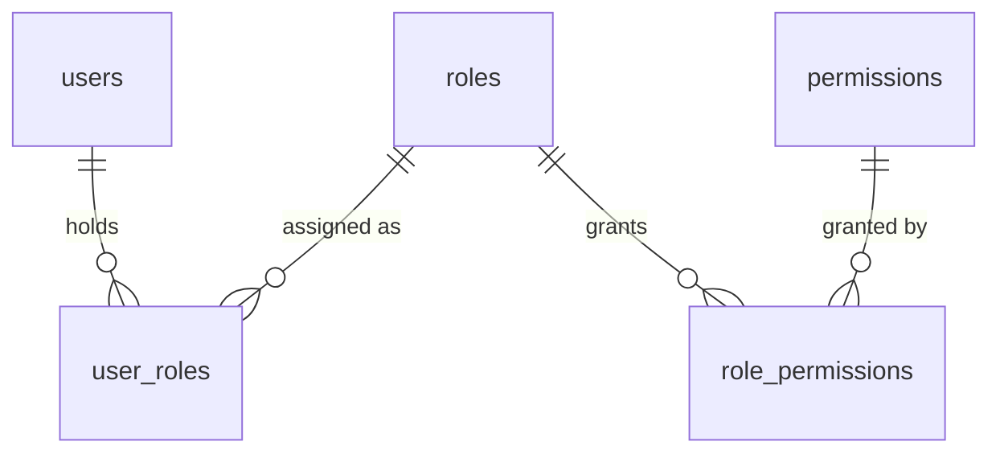

# Authorization

Role-based access control held in the database and enforced by the API.
Code: `services/api/internal/identity/principal.go`, `http.go`. Schema: migration `00004_identity.sql`.

## Model



- A **permission** is `<resource>.<action>` (`leads.export`). Handlers check permissions,
  never role names, so adding a role is data, not code.
- A **role** bundles permissions.
- A **role assignment** may carry a **scope** (`scope_type`, `scope_id`), for example a
  farmer for one supplier organisation, or kitchen staff for one kitchen. Global
  permission checks use **unscoped** assignments only; a scoped assignment grants nothing
  globally (`TestScopedRolesDoNotGrantGlobalAccess`). Scoped checks ("may this farmer see
  this supplier's purchase orders?") arrive with the modules that own those records,
  through a `CanIn(perm, scopeType, scopeID)` check in identity.
- Access is re-read on every request, so changes apply immediately.

## Permissions (Sprint 1)

Only permissions that guard something that exists:

| Permission | Guards |
|---|---|
| `admin.access` | Signing in to the admin console. Holders must use MFA outside local. |
| `analytics.view` | `GET /admin/stats/overview` |
| `leads.read` | `GET /admin/leads`, `GET /admin/leads/{id}` |
| `leads.update` | `PATCH /admin/leads/{id}` |
| `leads.export` | `GET /admin/leads/export.csv` |
| `leads.erase` | `DELETE /admin/leads/{id}` |
| `users.read` | Reserved for the staff screen (Sprint 2) |
| `users.manage` | Reserved for the staff screen; today `misectl` |

Renamed from pre-launch: `stats:read` → `analytics.view`, `leads:write` → `leads.update`,
`leads:*` → `leads.*`. A test fails if a permission the code checks is missing from the
database (`TestPermissionsInCodeExistInTheDatabase`, and `misectl doctor` in CI).

## Roles

| Role | Permissions today | Notes |
|---|---|---|
| `super_admin` | all eight | |
| `admin` | all except `users.manage` | |
| `marketing` | admin.access, analytics.view, leads.read, leads.export | |
| `operations` | admin.access, analytics.view, leads.read | |
| `support` | admin.access, leads.read, leads.update | |
| `finance`, `chef`, `kitchen_staff`, `nutritionist`, `farmer` | none yet | Created so assignments can be planned; granted permissions with their modules. `farmer` and `kitchen_staff` will be scoped. |
| `customer` | none | Customer endpoints are authorised by audience and ownership (a customer only ever acts on their own records). |

The pre-launch role map is carried over exactly.

## Enforcement

- **The API is the authority.** `identity.Service.RequireAdmin(permission, handler)` wraps
  every admin route; `RequireCustomer` wraps customer routes. The Next.js apps also hide
  what a role cannot use, as a convenience only.
- 401 `unauthorized`: no valid session for this audience. 403 `mfa_required`: second
  factor still due. 403 `forbidden`: signed in without the permission.
- Ownership: customer endpoints take no user id from the request; they act on the
  session's user (`DELETE /me/sessions/{id}` only matches the caller's sessions, tested).

## Managing access (until the staff screen exists)

```sh
MISE_ADMIN_PASSWORD='…' misectl admin create -email a@b.c -name "Ada" -role marketing
misectl admin grant  -email a@b.c -role support
misectl admin revoke -email a@b.c -role marketing
misectl admin disable -email a@b.c
```

Each is audited (`via: misectl`).

## Sprint 9.1 permissions

Granted by migrations 00015 and 00016; each route's permission is checked by the API and by the role matrix test.

| Permission | Roles | Guards |
|---|---|---|
| `payment_providers.read` | super_admin, admin, finance | `GET /admin/payment-providers` |
| `payment_providers.manage` | super_admin, admin | `PATCH /admin/payment-providers/{provider}` (enable, merchant status) |
| `payment_providers.activate` | super_admin | `POST /admin/payment-providers/{provider}/mode` (live approval) |
| `support_chat.read` | super_admin, admin, operations, support | Inbox, conversation, messages, read position, staff stream, agents, saved replies (read) |
| `support_chat.reply` | same | Reply, typing, priority/tags/links (`PATCH`); with `cases.manage`, escalate |
| `support_chat.assign`, `support_chat.transfer`, `support_chat.resolve` | same | Assign, transfer, resolve and reopen |
| `support_chat.internal_notes` | same | Add notes; notes appear in the conversation only with this permission |
| `support_chat.manage` | super_admin, admin | Chat settings and saved replies (write) |
| `support_chat.analytics` | super_admin, admin, operations | The Support chat dashboard |
| `help_centre.edit` | super_admin, admin, support, marketing | Help articles: list, create, edit drafts, submit, revise |
| `help_centre.publish` | super_admin, admin | Return to draft, publish, archive |

Customers and guests are authorised by ownership, never by permission: `/me/chat/*` acts on the session's customer and
`/chat/guest/*` on the guest token's session.
