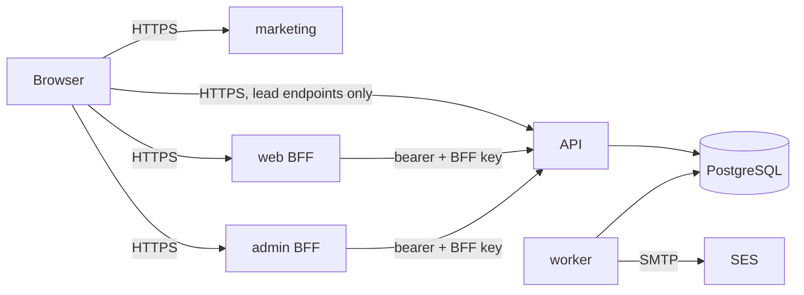

# Threat model

Written in Sprint 1; reviewed and extended in Sprint 9 (see the end). Scope: the API, worker, the three Next.js apps and PostgreSQL. The
pre-launch controls are in `docs/architecture/security.md` and still apply.

## Assets

1. The lead list (names, emails, phones, locations, preferences): the main asset today.
2. Customer accounts and, later, addresses, orders and payment references.
3. Staff accounts, especially those that can export or erase leads.
4. Secrets: `TOKEN_SIGNING_KEY`, `DATA_ENCRYPTION_KEY`, `BFF_SHARED_KEY`, database and SMTP credentials.

## Trust boundaries

## Threats and controls

| # | Threat (STRIDE) | Control | Status |
|---|---|---|---|
| T1 | Password guessing against one account (S) | Per-email limit 10/15 min; per-address limit; Argon2id; uniform 401; MFA for staff | Done |
| T2 | Credential stuffing from many addresses (S) | Per-email limit; WAF rate rule (AWS); breached-password check | Breached-password check **open** |
| T3 | Account enumeration via register/forgot/login (I) | Same answers and timing for known and unknown addresses; owners emailed instead | Done, tested |
| T4 | Session theft (S) | Tokens never reach the browser; httpOnly Secure cookies; hashed at rest; idle and absolute expiry; revocation | Done |
| T5 | Session fixation across the MFA step (S) | Token replaced on MFA success | Done, tested |
| T6 | TOTP replay or brute force (S) | Step used once; 5 wrong codes end the session; ±1 step only | Done, tested |
| T7 | Admin API reachable from the internet (E) | Every route authenticated, permissioned and MFA-gated. In AWS, `/api/v1/admin/*` is still publicly routable on the API host | **Open**: add a WAF rule allowing `/api/v1/admin/*` only from the admin task's egress, or move admin calls to a private listener |
| T8 | Privilege escalation via scoped roles (E) | Global checks ignore scoped assignments | Done, tested |
| T9 | Customer reaching admin, or the reverse (E) | Session audience bound and checked | Done, tested |
| T10 | CSRF on the apps (T) | Server actions only (same-origin POST), SameSite cookies, no GET state changes; API ignores cookies | Done |
| T11 | Spoofed client address to dodge limits (S) | Forwarded address believed only with `BFF_SHARED_KEY` | Done, tested |
| T12 | Email-token theft from the database or jobs table (I) | Tokens stored hashed; created at send time; single use; 1 h / 48 h | Done |
| T13 | Database leak exposes MFA secrets (I) | AES-256-GCM sealed, bound to user id; RDS encryption at rest | Done. Key derived from `TOKEN_SIGNING_KEY` where `DATA_ENCRYPTION_KEY` is unset; set it explicitly in staging and production |
| T14 | Inbox takeover leads to staff takeover (E) | Staff passwords not resettable by email | Done, tested |
| T15 | Repudiation of staff actions (R) | Audit log with actor, action, target and request id for sign-in, failures against real accounts, MFA, status changes, exports, erasure, operator actions | Done |
| T16 | Lead profile token in `localStorage` (I) | Scoped to one lead, low value, never grants an account | Accepted (pre-launch). Revisit when leads become accounts at launch |
| T17 | Per-process rate limits multiply with instances (D) | WAF backstop | Accepted until more than two API tasks |
| T18 | Signup and registration spam (D) | Honeypot and timing checks (waitlist), registration closed by default, per-address limits | CAPTCHA **open** for when registration opens |
| T19 | Secrets in the repository (I) | `.env*` gitignored; gitleaks in CI; secrets from Secrets Manager | Done |
| T20 | Vulnerable dependencies (T) | govulncheck, pnpm audit in CI | Done (CI not yet run on GitHub) |

## Logging rules

Never logged: passwords, tokens, TOTP codes or secrets, request bodies, query strings,
email addresses in auth events. Access logs record method, path, route, status, duration,
request id and trace id.

## Open items carried to Sprint 2

T2 breached-password check, T7 admin API exposure in AWS, T18 CAPTCHA before opening
registration, a manual review of the MFA screens with a screen reader, and a rehearsed
RDS restore.

## Sprint 9 review

Status of the Sprint 1 open items: **T2** (breached-password check) still open; **T7** (admin API reachable on the AWS API host) still
open, now also covering customer `/me/*` paths (finding F1 in `SECURITY_AUDIT.md`); single-server Caddy routes only public paths;
**T18** (CAPTCHA) still open, needed before public registration; the RDS restore is rehearsed locally only
(`docs/testing/MIGRATION_AND_RESTORE_RESULTS.md`).

Assets added since Sprint 1: customer addresses, household and allergy information, subscriptions, invoices, payment references
(no card data), orders, production, inventory and supplier records, delivery proof (recipient names, notes), analytics snapshots.

| # | Threat (STRIDE) | Control | Status |
|---|---|---|---|
| T21 | Forged or replayed payment webhook marks an order paid (S/T) | Signature verified, replay window, idempotent on provider event id, order-independent; browser redirect never marks payment | Done, tested (test provider). Re-assess for the real provider |
| T22 | Client tampers with price, discount or quantity (T) | Server quotes every amount; promotions approved and computed on the server; allowance enforced on the server | Done, tested |
| T23 | One customer reads another's order, invoice, address or delivery (I) | Every `/me/*` query scoped to the session's user | Done, tested on every id-bearing route |
| T24 | Staff role exceeds its job (E) | Permission per endpoint; role matrix test; courier sees only their runs | Done, tested |
| T25 | Open redirect through `next` after sign-in or address entry (S) | `safeNext` accepts only same-site paths | Done, tested |
| T26 | Demo or test data shown to customers (I/T) | `CATALOG_DEMO_ENABLED=false` in production; demo seeders refuse outside local; launch gate `demo_content_hidden` | Done |
| T27 | Automation bypasses financial or food-safety controls (E) | Rules need approval; actions limited to tasks and notifications; no automatic refunds or production changes | Done, tested (Sprint 8) |
| T28 | Lost events or silent job failure hide money or delivery problems (R/D) | Transactional outbox; at-least-once consumers with offsets; retries with backoff; failures visible on admin System | Done, tested |
| T29 | Delivery manifest leaks customer contact data to partners (I) | Manifest excludes email; courier sees only assigned deliveries | Done, tested |
| T30 | Backups unusable in an incident (D) | Encrypted RDS backups with PITR; restore rehearsal; runbooks | Rehearsed locally; **production restore not yet tested** |

## Sprint 9.1 review

Assets added: chat messages and internal notes, guest names and emails, guest tokens (hashed), help articles, payment provider
settings and their audit trail, provider-reported fees and exchange rates. Details: `PAYMENT_SECURITY.md`, `MESSAGING_SECURITY.md`.

| # | Threat (STRIDE) | Control | Status |
|---|---|---|---|
| T21 | (re-assessed) Forged or replayed webhook for Stripe or PayPal (S/T) | Stripe HMAC with tolerance and rotation; PayPal postback, byte-exact; event content never trusted, status fetched from the provider | Done, tested against fakes. **Re-verify in each sandbox** |
| T31 | Two providers both take money for one bill (T) | One open checkout per bill; the original attempt is settled with its own provider before another; uncertain outcomes block; renewals lock the bill | Done, tested |
| T32 | A provider reports a different amount or currency (T) | Recorded, flagged for finance, never applied | Done, tested |
| T33 | Provider credentials leak through the admin or database (I) | Environment / secret store only; masked references; live keys refused outside production | Done, tested |
| T34 | Unauthorised live payment activation (E) | `payment_providers.activate`, live credentials, verified merchant and a written reference; append-only audit | Done, tested |
| T35 | One customer or guest reads another's conversation (I) | Owner-scoped queries (404 otherwise); streams authorised before the first byte and on every delivery | Done, tested |
| T36 | Internal notes reach a customer (I) | Separate table and endpoints; streams carry ids only | Done, tested (API and browser) |
| T37 | Guest impersonation or account takeover through guest linking (S) | 256-bit token, hashed, httpOnly cookie; linking needs the token and a verified matching email | Done, tested |
| T38 | Chat spam and flooding (D) | Guest starts per email and address; 20 messages/min per sender; typing throttled; chat can be switched off | Done, tested |
| T39 | Stored XSS through messages or help articles (T) | Plain text only, React-escaped; help articles refuse angle brackets | Done, tested |
| T40 | Long-lived stream outlives a revoked session (S) | Session (and staff permission, MFA) re-checked every 60 s; 25-minute maximum | Done; the re-check itself is not covered by an automated test |
| T41 | Excessive retention of conversation data (I) | Proposal in `MESSAGING_SECURITY.md` §4 | **Open**: business/legal decision, then a purge job |
