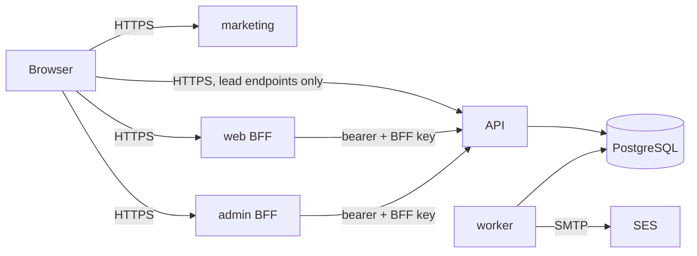

# Threat model (Sprint 1)

Scope: the API, worker, the three Next.js apps and PostgreSQL, as of Sprint 1. The
pre-launch controls are in `docs/architecture/security.md` and still apply.

## Assets

1. The lead list (names, emails, phones, locations, preferences): the main asset today.
2. Customer accounts and, later, addresses, orders and payment references.
3. Staff accounts, especially those that can export or erase leads.
4. Secrets: `TOKEN_SIGNING_KEY`, `DATA_ENCRYPTION_KEY`, `BFF_SHARED_KEY`, database and SMTP credentials.

## Trust boundaries

## Threats and controls

| # | Threat (STRIDE) | Control | Status |
|---|---|---|---|
| T1 | Password guessing against one account (S) | Per-email limit 10/15 min; per-address limit; Argon2id; uniform 401; MFA for staff | Done |
| T2 | Credential stuffing from many addresses (S) | Per-email limit; WAF rate rule (AWS); breached-password check | Breached-password check **open** |
| T3 | Account enumeration via register/forgot/login (I) | Same answers and timing for known and unknown addresses; owners emailed instead | Done, tested |
| T4 | Session theft (S) | Tokens never reach the browser; httpOnly Secure cookies; hashed at rest; idle and absolute expiry; revocation | Done |
| T5 | Session fixation across the MFA step (S) | Token replaced on MFA success | Done, tested |
| T6 | TOTP replay or brute force (S) | Step used once; 5 wrong codes end the session; ±1 step only | Done, tested |
| T7 | Admin API reachable from the internet (E) | Every route authenticated, permissioned and MFA-gated. In AWS, `/api/v1/admin/*` is still publicly routable on the API host | **Open**: add a WAF rule allowing `/api/v1/admin/*` only from the admin task's egress, or move admin calls to a private listener |
| T8 | Privilege escalation via scoped roles (E) | Global checks ignore scoped assignments | Done, tested |
| T9 | Customer reaching admin, or the reverse (E) | Session audience bound and checked | Done, tested |
| T10 | CSRF on the apps (T) | Server actions only (same-origin POST), SameSite cookies, no GET state changes; API ignores cookies | Done |
| T11 | Spoofed client address to dodge limits (S) | Forwarded address believed only with `BFF_SHARED_KEY` | Done, tested |
| T12 | Email-token theft from the database or jobs table (I) | Tokens stored hashed; created at send time; single use; 1 h / 48 h | Done |
| T13 | Database leak exposes MFA secrets (I) | AES-256-GCM sealed, bound to user id; RDS encryption at rest | Done. Key derived from `TOKEN_SIGNING_KEY` where `DATA_ENCRYPTION_KEY` is unset; set it explicitly in staging and production |
| T14 | Inbox takeover leads to staff takeover (E) | Staff passwords not resettable by email | Done, tested |
| T15 | Repudiation of staff actions (R) | Audit log with actor, action, target and request id for sign-in, failures against real accounts, MFA, status changes, exports, erasure, operator actions | Done |
| T16 | Lead profile token in `localStorage` (I) | Scoped to one lead, low value, never grants an account | Accepted (pre-launch). Revisit when leads become accounts at launch |
| T17 | Per-process rate limits multiply with instances (D) | WAF backstop | Accepted until more than two API tasks |
| T18 | Signup and registration spam (D) | Honeypot and timing checks (waitlist), registration closed by default, per-address limits | CAPTCHA **open** for when registration opens |
| T19 | Secrets in the repository (I) | `.env*` gitignored; gitleaks in CI; secrets from Secrets Manager | Done |
| T20 | Vulnerable dependencies (T) | govulncheck, pnpm audit in CI | Done (CI not yet run on GitHub) |

## Logging rules

Never logged: passwords, tokens, TOTP codes or secrets, request bodies, query strings,
email addresses in auth events. Access logs record method, path, route, status, duration,
request id and trace id.

## Open items carried to Sprint 2

T2 breached-password check, T7 admin API exposure in AWS, T18 CAPTCHA before opening
registration, a manual review of the MFA screens with a screen reader, and a rehearsed
RDS restore.
